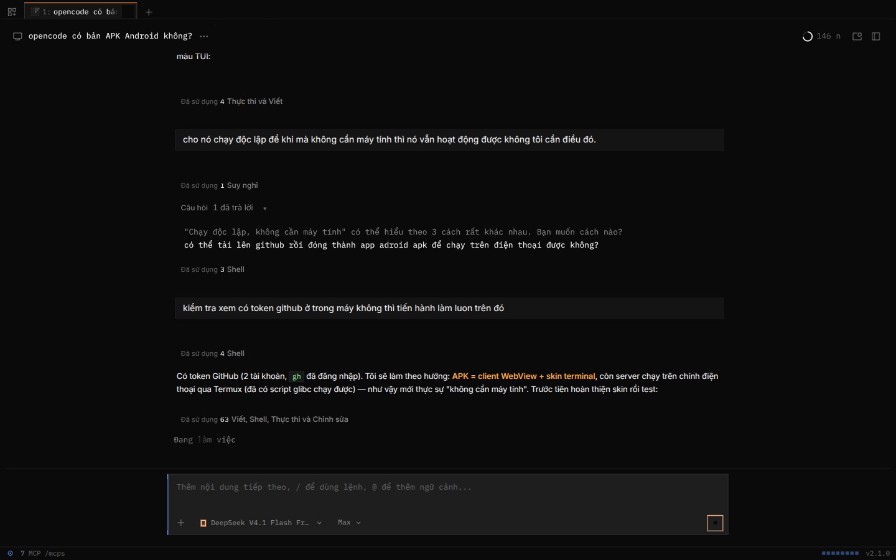
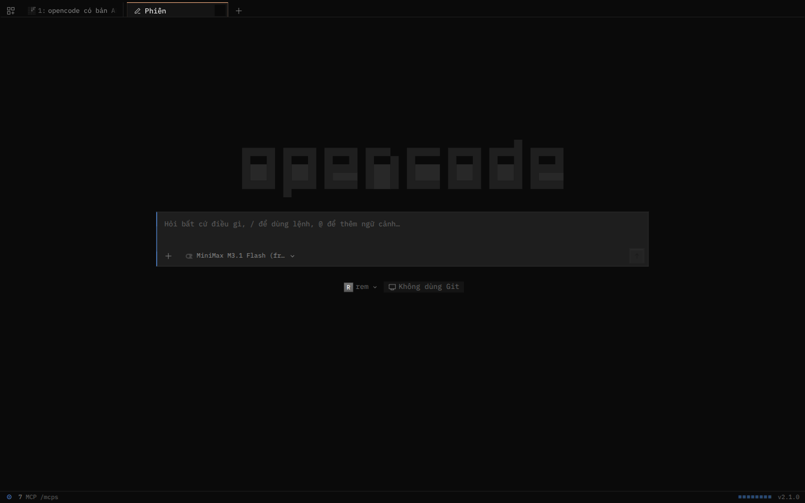

# OpenCode Terminal

Giao diện **terminal** cho web UI của [OpenCode](https://opencode.ai) + app Android (APK) đi kèm.



Phiên mới — logo ASCII, composer kiểu prompt, thanh trạng thái dưới cùng:



## Có gì trong repo

| Thư mục | Nội dung |
|---|---|
| `skin/` | CSS + JS biến web UI thành TUI: nền `#0a0a0a`, monospace, viền 1px, không bo góc, thanh trạng thái, logo ASCII |
| `android/` | APK WebView, tự chèn skin, có màn hình cài server URL và link pair |
| `termux/` | Script cài OpenCode server **ngay trên điện thoại** (Android aarch64) |

## Điều quan trọng nhất: APK không phải "bộ não"

OpenCode là **client–server**. APK/trình duyệt chỉ là giao diện; toàn bộ việc đọc file,
chạy lệnh, gọi model diễn ra ở **server OpenCode**. Vì vậy:

```
┌──────────────────┐    HTTP + SSE    ┌─────────────────────────────┐
│ APK / trình duyệt│ ───────────────▶ │ OpenCode server             │
│ (chỉ là UI)      │ ◀─────────────── │ Termux · VPS · máy tính     │
└──────────────────┘                  └─────────────────────────────┘
```

Muốn dùng **không cần máy tính** thì server phải chạy trên chính điện thoại
(bằng Termux) hoặc trên một VPS luôn bật. APK một mình không chạy được AI.

## 1. Điện thoại chạy một mình (Termux + APK)

Cần Termux bản **F-Droid** (bản Play Store bị lỗi thời) và máy Android 64-bit.

```bash
# trong Termux
bash install-opencode-termux.sh          # tải opencode bản linux-arm64, chạy qua glibc loader
opencode serve --hostname 127.0.0.1 --port 49374
```

Mở một session Termux khác:

```bash
opencode pair --url http://127.0.0.1:49374
# in ra link dạng http://127.0.0.1:49374/auth/connect/…
```

Cài APK (mục Releases), mở app → bấm **⚙** góc phải trên → dán link pair → **Lưu**.
App sẽ tự đăng nhập và hiện giao diện terminal.

> Android hay kill Termux. Bật `termux-wake-lock` và cài **Termux:Boot** để server
> tự chạy lại; script có kèm file boot mẫu.

## 2. Dùng trên máy tính (proxy chèn skin)

Không sửa file cài đặt của opencode — chỉ chạy thêm một proxy nhỏ:

```bash
bun skin/server.mjs         # http://127.0.0.1:49375  →  :49374
```

Mở `http://127.0.0.1:49375`, đăng nhập bằng link `opencode pair` (đổi cổng 49374 → 49375).
Tắt proxy là quay về giao diện gốc.

## 3. VPS / máy chủ luôn bật

```bash
opencode serve --hostname 0.0.0.0 --port 49374
opencode pair --remote        # link truy cập từ ngoài, có mật khẩu
```

Rồi nhập URL đó vào app (⚙ → Server URL) hoặc mở bằng trình duyệt điện thoại.
Nhớ đặt sau reverse proxy HTTPS nếu đưa ra internet.

## Build APK

CI tự build mỗi lần push (`.github/workflows/android.yml`), artifact tên
`opencode-terminal-apk`. Build tay:

```bash
export JAVA_HOME=/usr/lib/jvm/java-17-openjdk-amd64
cd android && ../gradle-8.7/bin/gradle assembleDebug
# android/app/build/outputs/apk/debug/app-debug.apk
```

Yêu cầu: JDK 17 (có `jlink`), Android SDK platform 34, build-tools 34.0.0.

## Skin hoạt động thế nào

- CSS bám vào các thuộc tính ngữ nghĩa có sẵn của app: `[data-slot=…]`,
  `[data-component=…]` (titlebar, composer, user-message, markdown…), không phụ thuộc
  class Tailwind sinh tự động.
- Ghi đè token màu `--v2-*` bằng bảng màu TUI chính thức
  (`packages/ui/src/theme/themes/opencode.json`): nền `#0a0a0a`, chữ `#eeeeee`,
  accent `#fab283`, blue `#5c9cf5`.
- `tui.js` thêm status bar, logo ASCII, đánh số tab, và ép `data-color-scheme=dark`.
- APK chèn `<style>` + chạy JS qua `evaluateJavascript` (CSP của app cho phép
  `style-src 'unsafe-inline'`, script thì chạy qua API native nên không bị chặn).

Đã kiểm tra với OpenCode **2.1.0**.

## Giới hạn

- Skin là lớp trình bày; app gốc vẫn quyết định hành vi.
- Một số nhãn phụ thuộc ngôn ngữ của app (vi/en), skin không dịch.
- WebView trên Android có thể khác Chrome ở vài chi tiết nhỏ (scroll, font fallback).

## Giấy phép

MIT.
